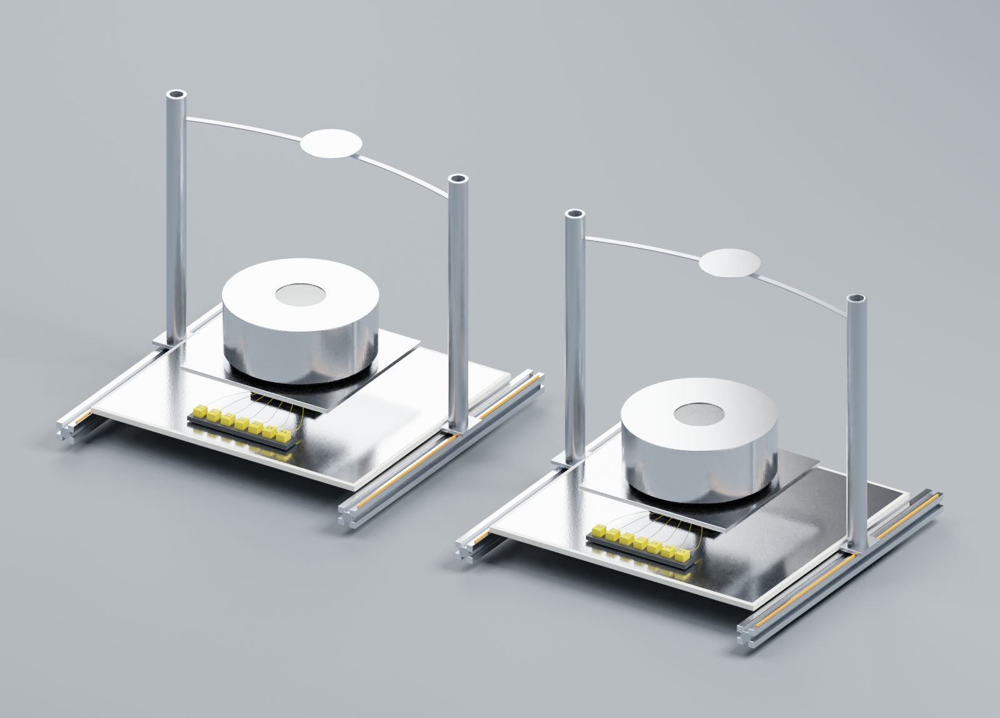

# Cooling pilot geometry v2

Original metric Blender geometry for the paired directional-cooling apparatus,
an exploded inspection variant, a fixed-band variant, a Keithley 2425 exterior,
a USB-TC terminal enclosure, an A25 bath with an explicitly inferred AC150 head,
Cary5000/DRA2500 and Nicolet6700/IntegratIR optical compartments, and an EKO STR-32G.
The scene is a review arrangement, not the actual rooftop or laboratory layout.

Inspect [the native Blender scene](geometry/cooling_pilot.blend),
[the GLB](geometry/cooling_pilot.glb), [named parts](parts.json),
[dimensions and their provenance](dimensions.json), and
[equipment identity/search decisions](equipment_research.json).
Further views show the [stack](evidence/exploded_stack.png),
[fixed band](evidence/fixed_band.png), [commercial devices](evidence/commercial_devices.png),
[2425](evidence/keithley_2425.png), [USB-TC](evidence/usb_tc.png),
[optical instruments](evidence/optical_instruments.png) and [solar tracker](evidence/solar_tracker.png).

Source comparison: [paper supplement, Figure 1](https://media.springernature.com/original/springer-static/esm/art%3A10.1038%2Fs41467-018-07293-9/MediaObjects/41467_2018_7293_MOESM1_ESM.pdf),
[2425 dimensions](https://download.tek.com/document/2425RevC_DocSpec.pdf),
[A25 dimensions, p2-2](https://documents.thermofisher.com/TFS-Assets/LED/manuals/D00167~.pdf),
[USB-TC manual](https://files.digilent.com/manuals/USB-TC.pdf).
The 2400-series manufacturer CAD archive was inspected and contains no 2425;
its 2400 and 2410 STEP files were not relabeled or imported.

`build_scene.py` and `extra_devices.py` are the editable sources. Blender 2.82 was used with Cycles CPU.
Run `blender --background --python-exit-code 1 --python build_scene.py -- --render`
from this directory. Unit scale is one metre. The GLB excludes studio lights,
camera and presentation floor. Part IDs remain stable across the native/exported
representations; curves and lettering are explicitly converted for GLB export.
`compact_glb.py` deduplicates identical binary data without quantizing geometry.
Visual materials are not measured optical or thermal models.

This revision is **not equipment-fidelity accepted**. Optical accessory fit,
remaining weather/solar sensors, heater fit, exact port placement and robot-level
interaction bindings remain open. The 2425 panel uses a manufacturer-described
family layout, not a verified serial-specific scan. The A25 controller variant
is inferred. Nicolet dimensions and its selected DTGS detector variant are also
inferred; source photos support the recognizable layout, not every dimension.
The track curve is illustrative until bound to site/date geometry. The source's
107 mm spacer bore and 102 mm PE support diameter leave an unspecified cover
load path; this is an open attachment-design issue, not a validated assembly.
Mass, friction, joints, contacts, reachability and film mechanics are unvalidated.
These limitations are machine-readable and cannot be hidden by a rendered image.

All included geometry and procedural materials are newly authored under the
repository's license. No vendor CAD, product photographs or manuals are included.
Manufacturer/model names are identification, not endorsement.
