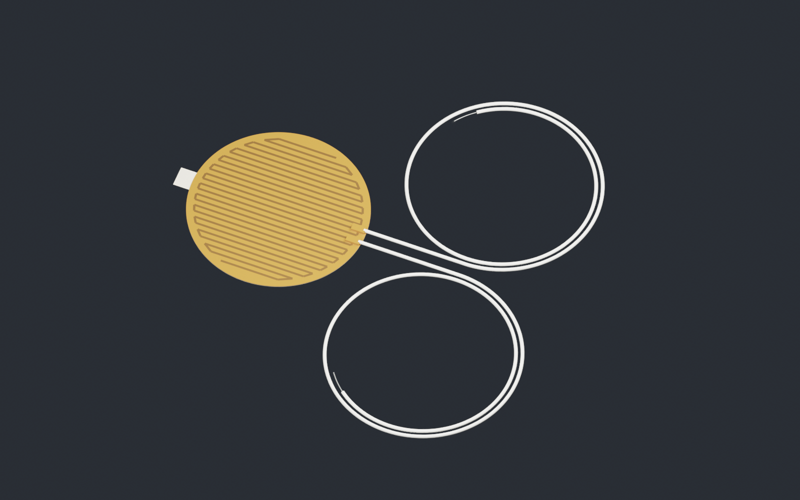

# Omega KHR-2/2-P

A metric reconstruction of the paper's round polyimide heater, retaining the
50.8 mm commercial diameter, two separate radial leads and 305 mm lead length.
The 50 mm emitter leaves a 0.4 mm radial overhang; the heater has not been shrunk
to conceal that mismatch.

Inspect the [GLB](geometry/omega_khr_2_2_p.glb),
[editable Blender file](geometry/omega_khr_2_2_p.blend),
[interfaces](interfaces.json), [source decisions](sources.json), and
[exported geometry checks](geometry_checks.json).

The manufacturer [family sheet](https://kr.omega.com/Heaters/pdf/KHR_KHLV_KH.pdf)
provides the round outline, radial lead exit, FEP lead specification and maximum
0.010 inch body thickness. The selected 0.2 mm thickness, internal foil routing,
wire gauge, reinforcement patches and liner handling tab are inferred. The
family photograph supports the construction style; it does not verify the
exact internal resistor path. No vendor CAD was retrieved.

The current family table leaves the 2.5 W/in² entry blank for the two-inch
heater. The paper and an older Omega-authored catalog ordering example identify
KHR-2/2-P. This model does not claim current availability or an electrically
qualified resistance. Four-wire measurement connects distinct force and sense
conductors to each of the two heater nodes; it does not create four fictitious
manufacturer leads.

Run `blender -b --python-exit-code 1 --python build.py` and `python validate.py`.
The GLB includes all eleven named parts. Lead paths have no self-overlap or
mutual intersection. These geometry checks do not validate peeling, adhesion,
flexure, heating or robot attachment.
